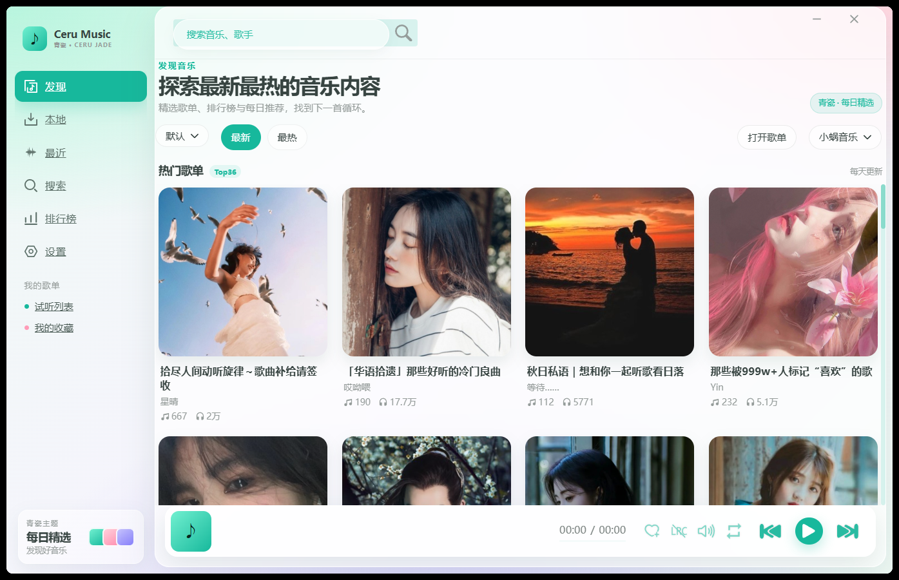
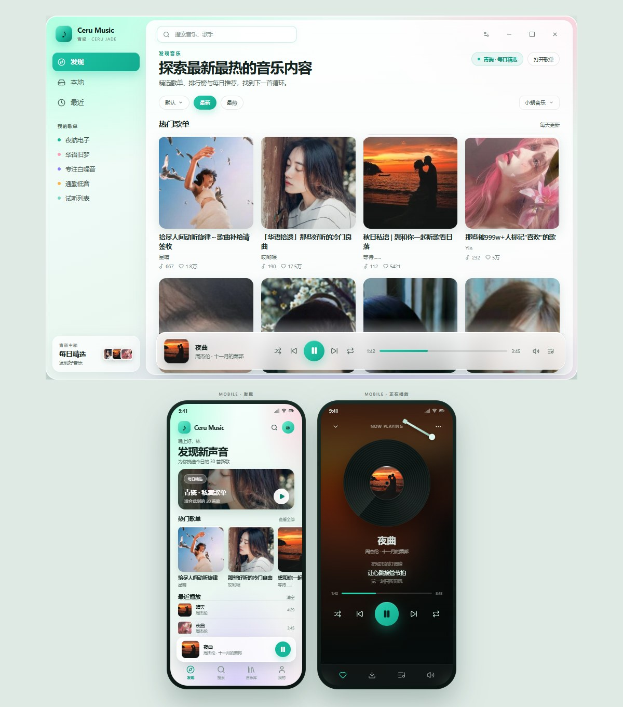

# LX Music · 青瓷 (Ceru Jade)

基于 [lyswhut/lx-music-desktop](https://github.com/lyswhut/lx-music-desktop) **v2.12.6** 与 [lyswhut/lx-music-mobile](https://github.com/lyswhut/lx-music-mobile) **v1.9.1** 的非官方 UI 改版。

**当前版本：`v2.12.6-ceru.11`（青瓷改版 rev.11，移动端 `v1.9.1-ceru8`）**



## 下载

**Release：** https://github.com/baipiao5555/lx-music-ceru-jade/releases/tag/v2.12.6-ceru.11

| 平台 | 文件 | 说明 |
| --- | --- | --- |
| Windows x64 | `lx-music-desktop-v2.12.6-x64-Setup.exe` | NSIS 安装包，116 MB，未做商业签名（与 ceru.9 相同） |
| Android arm64 | `lx-music-mobile-v1.9.1-ceru8-universal.apk` | 28 MB，推荐，含澜音 v1 布局 + 歌单导入 |
| Android arm64 | `lx-music-mobile-v1.9.1-ceru8-arm64.apk` | 14 MB，体积更小，含澜音 v1 布局 + 歌单导入 |

SHA-256：

- Windows：`3d016a1ce9cae4866797e2be12839a2e6fc722cba69dc14142bed7443db8aa20`
- Android universal：`7499c99ec925a6fedd268b681310df37f6607b54503f0a81238ed4a7701f9030`
- Android arm64：`b1389882654d9fd2df14919167a33a056d29201bec20a15cff85f7a142732bcd`

## 版本记录

### rev.11（`v2.12.6-ceru.11` + 移动端 `v1.9.1-ceru8`）

- 修复歌单导入弹窗的文字看不清：未选中的平台标签、取消按钮、顶部「导入」胶囊原来是绿底绿字。
- 未选中平台与取消按钮改为浅色底 + 深色文字 + 边框；顶部胶囊改为浅底深绿字。
- 「示例」链接文字加深，便于辨认。
- 构建标记更新为 `Ceru 构建 8 · 已内置歌单导入`。
- 桌面端安装包与 ceru.9 相同，未重新打包。

### rev.10（`v2.12.6-ceru.10` + 移动端 `v1.9.1-ceru7`）

- 移动端新增内置歌单导入，不依赖澜音插件：支持网易云、QQ 音乐、酷狗、酷我、咪咕。
- 支持粘贴歌单链接、整段分享文案或纯歌单 ID；短链交给各平台 SDK 跟随跳转解析。
- 导入后自动新建同名本地歌单并切换过去；列表保留来源信息，可继续「同步」刷新。
- 入口放在「发现」和「音乐库」页右上角的「导入」胶囊按钮，音乐库列表栏也保留一个。
- 「我的 → 版本」增加构建标记 `Ceru 构建 7 · 已内置歌单导入`，用于确认安装的是新包。
- 桌面端安装包与 ceru.9 相同，未重新打包。

### rev.9（`v2.12.6-ceru.9`）

- 侧栏移除「Ceru Music / 青瓷 · CERU JADE」品牌文字，只保留图标。
- 侧栏新增「收藏」，放在「本地」上方，并修正收藏图标尺寸。
- 「最近」改为真实播放历史：最新在前，最多 200 首，本地持久化。
- 「发现」页恢复「导入歌单」，支持粘贴完整分享文案。
- 修复播放栏封面尺寸失控遮挡页面的问题。
- 修复窗口只有最大化、无法还原和拖动的问题。
- 提供 NSIS 安装程序，安装后自动创建桌面和开始菜单快捷方式。

### rev.8（`v2.12.6-ceru.8` + 移动端 `v1.9.1-ceru5`）

- 移动端移除洛雪式抽屉 / 汉堡菜单，改为底部四栏导航：发现 / 搜索 / 音乐库 / 我的。
- 顶部改为 Ceru Music 品牌栏 + 排行榜 / 搜索 / 头像入口。
- 发现页改为概念稿布局：问候语 +「发现新声音」+ 每日精选 Hero + 横滑热门歌单 + 最近播放。
- 播放条改为悬浮迷你卡片，只在实际播放时显示；播放键改为青绿圆形按钮。
- 设置页改为白色卡片分组，字体预览 / 关于页品牌改为 Ceru Music。
- 搜索页改为圆角搜索框 +「全部音源」胶囊。
- 空封面占位由「LX」改为音符图标；桌面安装包与 rev.7 相同。

### rev.7（`v2.12.6-ceru.7` + 移动端 `v1.9.1-ceru4`）

- 桌面端按澜音 v1 平面风格重构：移除粉紫渐变与毛玻璃面板，改为浅色平面外壳。
- 侧栏改为 240px：Ceru Music 品牌 + 发现 / 本地 / 最近，移除「我的歌单」快速链接。
- 窗口按钮改为澜音同款黄 / 绿 / 红三色圆点。
- 播放条改为贴底通栏，去掉外边距和悬浮圆角。
- 歌单详情页改为大封面头部 + 歌曲数 + 胶囊按钮。
- 移动端发现页改为「发现音乐」+「热门歌单Top36」+ 白色歌单卡片，移除 Hero 大卡和筛选栏。
- 移动端播放条改为贴底通栏，抽屉品牌改为 Ceru Music，移除主题装饰卡。
- 重新构建并签名移动端 APK。

### rev.6（`v2.12.6-ceru.6`）

- 播放条改为左 / 中 / 右三段式：左侧封面与歌曲信息，中间上一首 / 播放 / 下一首，右侧时间与功能按钮。
- 修复播放条歌曲信息区被误加渐变背景、出现绿色横线的问题，播放键组严格居中。
- 收紧窗口关闭按钮右侧留白（工具栏右内边距 16px → 6px，窗口按钮宽度 46px → 38px）。
- 工具栏改为三列栅格，窄窗口下搜索框自动收缩，不再与右侧按钮重叠。
- 热门歌单恢复默认「最新」排序，避免部分音乐源「最热」接口加载失败。
- 重新打包 Windows 安装包，SHA-256 已更新；移动端 APK 与 rev.3 相同。

### rev.5（`v2.12.6-ceru.5`）

- 「发现音乐」页按澜音 CeruMusic 界面重做：移除筛选胶囊、导入歌单、来源选择，保留大标题与「热门歌单Top36」。
- 歌单卡片改为白色圆角卡片（整块封面、标题、精选歌单、播放量、曲目数胶囊），四列自适应网格。
- 热门歌单默认「最热」排序。
- 修复首页与侧栏文字下划线。
- 修复右侧内容区宽度塌陷（`#body` id 与页面 `<body>` 冲突）。
- 修复歌单卡片点击无反应，实机验证可进入歌单详情。
- 启动固定进入「发现」页，不再恢复上次的搜索页或详情页。
- 搜索框自适应宽度，窄窗口下不再与窗口按钮重叠。
- 重新打包 Windows 安装包，SHA-256 已更新；移动端 APK 与 rev.3 相同。

### rev.4（`v2.12.6-ceru.4`）

- 桌面端对齐在线预览：Ceru Music 品牌、发现 / 本地 / 最近导航、我的歌单圆点、底部迷你封面卡片、热门歌单 Top36。
- 播放条改为悬浮圆角卡片，加入青绿圆形播放按钮。
- 启动固定进入「发现」页，不再恢复上次的搜索页。
- 重新打包 Windows 安装包，SHA-256 已更新。
- 移动端 APK 与 rev.3 相同。

### rev.3（`v2.12.6-ceru.3`）

- 移动端实际 APK 落地青瓷 UI 第一版：默认「发现」页、抽屉品牌头与胶囊导航、两列歌单卡片、悬浮播放条、搜索页品牌空状态。
- 抽屉顺序调整为 发现 / 搜索 / 排行榜 / 我的列表 / 设置，启动默认进入发现。
- 新增移动端布局补丁（现合并为 `0002-feat-ui-ceru-mobile.patch`）。
- 桌面端安装包与 rev.2 相同。

### rev.2（`v2.12.6-ceru.2`）

- 桌面端启动默认进入「歌单」青瓷首页，不再先落在搜索页。
- 首次启动不再弹出版本更新日志。
- 重新打包 Windows 安装包，SHA-256 已更新。
- 新增桌面端 + 手机端 UI 概念预览，见下方「设计预览」。
- 移动端 APK 仍为主题版，完整布局改版待落地。

### rev.1（`v2.12.6-ceru.1`）

- 桌面端青瓷 UI 首版、Windows 安装包与 Android 主题版 APK。

## 本次改动

### 桌面端（完整 UI 改版）

- 新增「青瓷」主题：青绿主色、澜音 v1 平面浅色外壳，并设为默认主题。
- 启动固定进入「发现」页（原歌单页），不再恢复上次搜索页或详情页；首次启动不弹出版本更新日志。
- 侧栏：240px，Ceru Music 品牌（青瓷 · CERU JADE）、发现 / 本地 / 最近导航。
- 首页：`发现音乐` 大标题、热门歌单 Top36、四列白色歌单卡片（整块封面 + 精选歌单 + 播放量 + 曲目数）、悬停上浮。
- 顶栏：返回/前进、自适应搜索框、排行榜/设置按钮、黄 / 绿 / 红三色窗口圆点；窗口变窄时搜索框自动收缩。
- 贴底通栏播放条，青绿圆形播放按钮，播放键组居中，时间与功能按钮分列两侧。
- 歌单详情页：大封面头部 + 歌曲数 + 胶囊按钮。
- 播放详情页：黑胶唱片 + 唱臂 + 玻璃歌词面板样式。
- 主题名称的中/繁/英/韩翻译。

### 移动端（澜音 v1 布局）

- 新增「青瓷」主题并设为默认：青绿主色、浅色主背景。
- 底部四栏导航：发现 / 搜索 / 音乐库 / 我的，移除洛雪式抽屉 / 汉堡菜单。
- 顶部 Ceru Music 品牌栏 + 排行榜 / 搜索 / 头像入口。
- 发现页：问候语 +「发现新声音」+ 每日精选 Hero + 横滑热门歌单 + 最近播放。
- 悬浮迷你播放条（仅播放时显示），青绿圆形播放键。
- 设置页白色卡片分组；搜索页圆角搜索框 +「全部音源」胶囊。
- 空封面占位改为音符图标。

## 设计预览（概念稿）

桌面端 + 手机端概念稿：



- 桌面端：真实封面、两行歌单、筛选胶囊、悬浮播放条。
- 手机端 · 发现：每日精选大卡、横滑歌单、最近播放、迷你播放器。
- 手机端 · 正在播放：黑胶 + 唱臂、歌词高亮、完整控制。

手机端单独查看：[发现页](design/mobile-discover.jpg) · [正在播放页](design/mobile-player.jpg)

在线预览（GitHub Pages）：https://baipiao5555.github.io/lx-music-ceru-jade/design/preview.html

> 说明：桌面端 rev.7 已按澜音 v1 平面风格重构外壳、发现页和详情页；移动端 rev.8 已按概念稿改为底部四栏导航、Hero + 横滑歌单 + 最近播放、悬浮迷你播放条和卡片化设置页。

## 为什么是补丁仓库

Mimosa 的 Git 安全门禁在提交前扫描到上游源码中的 12 个既有高危项（音乐源加密、同步路径处理等），按规则阻止了完整源码提交。本仓库只包含本次 UI/主题改动，避免重新分发上游高风险代码；上游项目仍采用 Apache-2.0 许可。

## 补丁文件

- `patches/0001-feat-ui-ceru-jade.patch`：桌面端青瓷 UI，基于官方 v2.12.6。
- `patches/0002-feat-ui-ceru-mobile.patch`：移动端青瓷主题 + 澜音 v1 布局 + 歌单导入，基于官方 v1.9.1。

## 应用补丁

### 桌面端

```bash
git clone --depth 1 --branch v2.12.6 https://github.com/lyswhut/lx-music-desktop.git
cd lx-music-desktop
git apply /path/to/patches/0001-feat-ui-ceru-jade.patch
```

Windows 构建参考：

```bash
npm install --ignore-scripts --registry=https://registry.npmmirror.com
node build-config/postinstall.js
# 将 Electron 42.11.6 win32-x64 运行时解压到 node_modules/electron/dist
# 写 node_modules/electron/path.txt，内容为 electron.exe（不要带换行）
npm run build
.\node_modules\electron\dist\electron.exe dist\main.js
```

### 移动端

```bash
git clone --depth 1 --branch v1.9.1 https://github.com/lyswhut/lx-music-mobile.git
cd lx-music-mobile
git apply /path/to/patches/0002-feat-ui-ceru-mobile.patch
npm run build:theme
npm install --legacy-peer-deps --registry=https://registry.npmmirror.com
```

Android 构建环境：JDK 17、Android SDK Platform 36、Build-Tools 35.0.0、NDK 26.1.10909125、Node 18、Gradle 8.8。生成 arm64 release APK：

```bash
cd android
gradlew.bat assembleRelease -PreactNativeArchitectures=arm64-v8a --no-daemon
```

需要在 `android/keystore.properties` 配置自己的 keystore；不要使用仓库外泄的签名文件。

## 说明

- 播放详情页的黑胶样式已编译通过，但当前环境没有可用播放源，未实际播放验证。
- Windows 安装包和 Android APK 都是自签名，系统可能提示未知发布者/未知来源。
- 移动端 universal APK 含 arm64-v8a 等 ABI；arm64 版体积更小。要求 Android 5.0+；如已安装其它签名的洛雪，需要先卸载。
- 应用补丁后如果仍显示旧主题，到「设置 → 主题」选择「青瓷」；新配置默认就是青瓷。

## 许可

补丁基于上游 v2.12.6 / v1.9.1，遵循 **Apache-2.0**。原项目版权归 lyswhut 及贡献者所有。本仓库为非官方改版，与上游无隶属关系。
