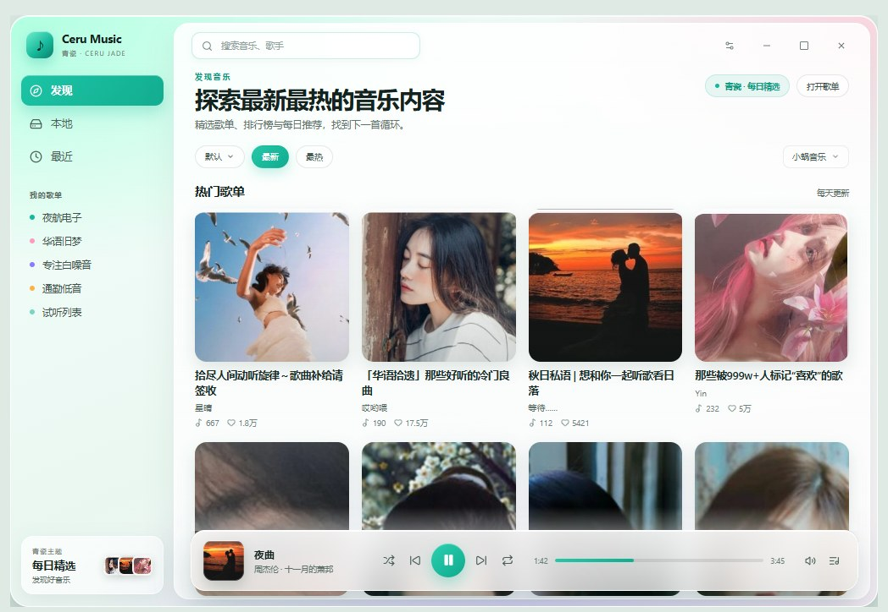
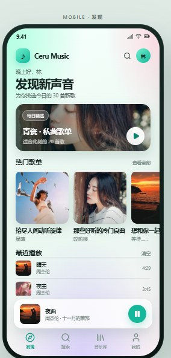
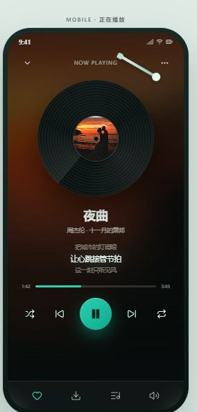

# 青瓷 UI 概念预览 · rev.2

对应版本：`v2.12.6-ceru.2`

## 桌面端

- 真实封面、两行歌单、筛选胶囊、来源选择
- 悬浮玻璃播放条、悬停播放按钮
- 侧栏品牌、我的歌单、青瓷主题卡片

## 手机端 · 发现

- 每日精选大卡、横滑歌单、最近播放
- 悬浮迷你播放器、底部导航

## 手机端 · 正在播放

- 模糊封面背景、黑胶唱片 + 唱臂
- 歌词高亮、进度条、完整播放控制

## 说明

- 本目录是 UI 概念稿，用于确认下一版视觉方向。
- `v2.12.6-ceru.2` 的 Windows 安装包是已落地的桌面青瓷 UI（启动默认进入歌单首页）。
- Android APK 仍为青瓷主题版，手机端完整布局尚未落地到 React Native。
- 在线预览：https://baipiao5555.github.io/lx-music-ceru-jade/design/preview.html
